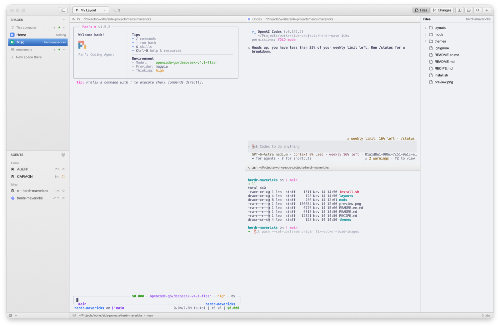
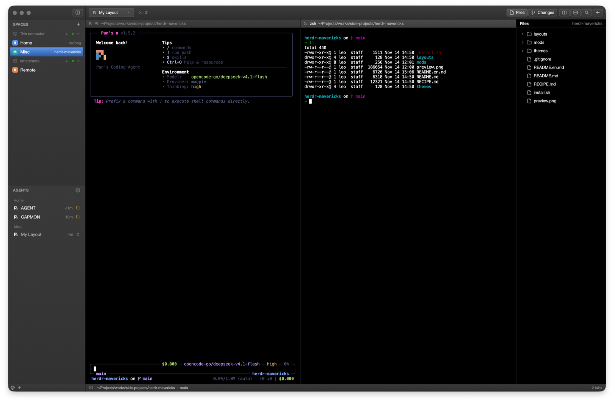

# Herdr · Mavericks

English · [中文](README.md)

A **Mavericks-like layout** for [Herdr](https://herdr.dev): the window is drawn as an OS X 10.9
app — a full-height Finder-style sidebar, one 40px toolbar across the work area (tabs and view
controls in the same row), Aqua capsule buttons, pane headers that look like native title bars,
system-blue selection and Helvetica Neue. Only the structure and the looks change; terminals,
agents, machines and worktrees keep working the way Herdr does.



| Light | Dark |
| --- | --- |
|  |  |

## Where it comes from

Inspired by [forrestchang/multica-mavericks](https://github.com/forrestchang/multica-mavericks),
which turns 10.9's visual language — Aqua gradients, system-blue selection, hairline grey chrome,
Lucida Grande / Helvetica Neue — into a Multica theme. This repo brings the same language to
Herdr's layout system: the sidebar, toolbar, pane headers, status bar, menus and panels are
redrawn as mods, on top of a matching light/dark 10.9 theme.

## Install

```sh
./install.sh            # copy into ~/.config/herdr-app
./install.sh --link     # symlink instead; edits here apply live
herdr-app do layout.switch --name mavericks
```

Back to your old layout: `herdr-app do layout.switch --name main`.
The themes only appear while this layout is shown (a theme named after a layout belongs to it):
`mavericks` in the light appearance, `mavericks-dark` in the dark one, following the system.

## What is in here

| Path | Purpose |
|---|---|
| `layouts/mavericks.json` | The whole window: a full-height sidebar plus the work area (toolbar, panes, status bar). `titlebar: none`; the traffic lights sit at `traffic_lights [12, 13]` |
| `themes/mavericks.json` | Light theme: 10.9 chrome greys, system-blue accent, Terminal.app Basic 16 colors |
| `themes/mavericks-dark.json` | Dark appearance: the same structure in dark greys, with a graphite terminal at `#1f1f1f` |
| `mods/mavericks/` | Hand-drawn parts, dispatched by `props.role`: `brand`, `chrome`, `pane`, `status`, `footer` |
| `mods/mavericks-spaces/` `-agents/` | Sidebar lists (clones of Herdr's `spaces` / `agents`, looks only) |
| `mods/mavericks-menu/` `-files/` `-changes/` | Context menu and two panels (clones of the shipped mods, looks only) |
| `install.sh` | Installs into Herdr's config folder; `--link` for development |

Fonts: Helvetica Neue for UI, Menlo 12 for terminals. Both ship with macOS; without them Herdr
falls back to Geist / JetBrains Mono.

## Docs

| File | What it is |
|---|---|
| [RECIPE.md](RECIPE.md) | The build brief: another agent with an empty folder can rebuild this layout from it |
| [STYLE.md](STYLE.md) | The style rules this layout follows, in Chinese, for future layouts of the same family |
| [preview.png](preview.png) · [preview-dark.png](preview-dark.png) | Screenshots in light and dark (the gallery uses `preview.png`) |

## Publish to the Herdr gallery

The gallery picks repos up by GitHub topic: no sign-up, no pull request.

1. The repo is **public**, and the root (or one folder inside it) holds `layouts/mavericks.json`,
   `mods/`, `RECIPE.md` and `preview.png`.
2. Add the topic `herdr-layout`:

   ```sh
   gh repo edit --visibility public \
     --add-topic herdr-layout \
     --description "OS X 10.9 Mavericks look for Herdr: full-height sidebar, one unified toolbar, Aqua buttons"
   ```

3. Within the hour it shows up under Community on [herdr.dev/gallery](https://herdr.dev/gallery)
   as `herdr.dev/layouts/<owner>/<repo>` (one repo can hold several layouts, one folder each).

The line people copy from the gallery reads:

```text
Read ~/.config/herdr-app/AGENTS.md, then add this layout: herdr.dev/layouts/HaiFongPan/herdr-mavericks
```

## Known limits (short version)

- Herdr's own overlays whose mod names are hard-coded at the call site (close confirmation,
  renames, new-menu, picker, Settings, command palette) cannot be reskinned; only theme colors
  follow. The context menu has been replaced by `mavericks-menu`.
- Overlay corners show a small square behind the rounded frame: Herdr rounds its own border but
  does not clip the mod's background. Not settable from the theme.
- `mavericks-spaces` / `-agents` are clones of Herdr 0.1.15; re-clone when Herdr's internals change.
- Herdr does not redraw layout mods when the appearance changes, so each mod compares the theme
  signature once a second: the window can take up to a second to change color.
- No Dock, Launchpad, menu bar or sounds: they sit outside the window content, or need an extra
  always-on floating block.

The full list is in *Watch out* in [RECIPE.md](RECIPE.md).

## License

Apache License 2.0 — see [LICENSE](LICENSE) and [NOTICE](NOTICE). Several mods here are styling
clones of Herdr's own mods (Apache-2.0); the sources and versions they were cloned from are listed
in NOTICE.

Apple, OS X, Aqua and Mavericks are trademarks of Apple Inc. This layout is not affiliated with or
endorsed by Apple.
