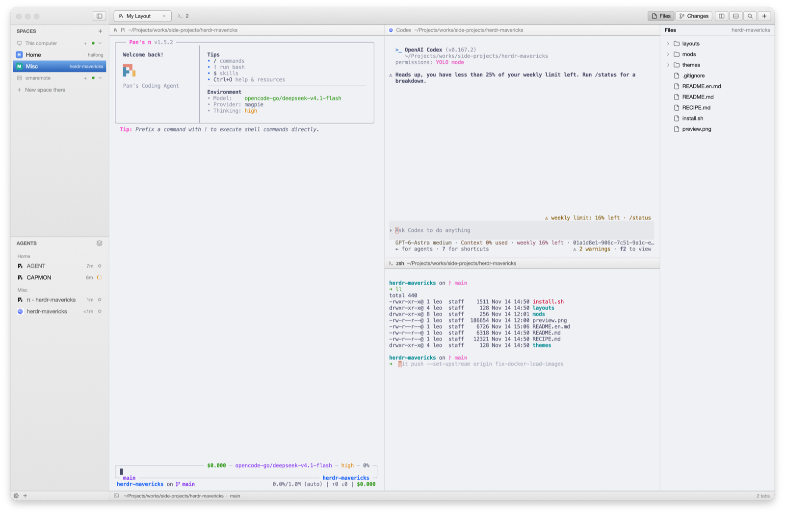
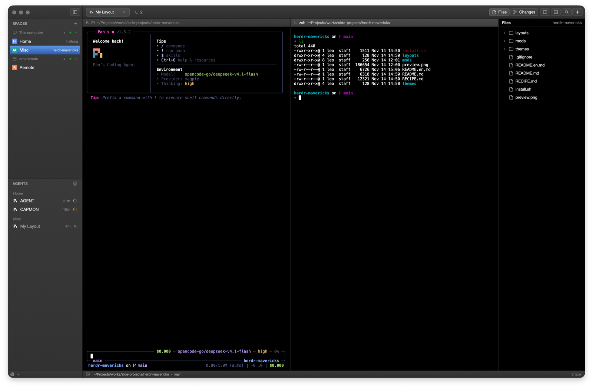

# Herdr · Mavericks

[English](README.en.md) · 中文

一个用 [Herdr](https://herdr.dev) 搭出来的 **Mavericks-like layout**：把窗口画成 OS X 10.9
时代的 macOS 应用——贯通到底的 Finder 式侧栏、工作区顶部一条 40px 统一工具栏（标签页和视图
按钮同一行）、Aqua 胶囊按钮、原生标题栏样式的 pane 标题、系统蓝选中、Helvetica Neue。
只换窗口的结构和外观，Herdr 的终端、agent、机器和 worktree 逻辑都不动。



| 浅色外观 | 深色外观 |
| --- | --- |
|  |  |

## 灵感

来自 [forrestchang/multica-mavericks](https://github.com/forrestchang/multica-mavericks)：
一个把 10.9 的视觉语言（Aqua 渐变、系统蓝选中、灰阶细描边、Lucida Grande / Helvetica Neue）
做成 Multica 主题的作品。这个仓库把同一套语言搬到了 Herdr 的布局系统上，用 mod 重画
侧栏、工具栏、pane 标题、状态栏、菜单和面板，并单独做了一套深浅两用的 10.9 主题。

## 安装

```sh
./install.sh            # 复制到 ~/.config/herdr-app
./install.sh --link     # 软链，改仓库即生效（开发用）
herdr-app do layout.switch --name mavericks
```

切回原来的布局：`herdr-app do layout.switch --name main`。
`mavericks` 主题只在这个布局下出现（与布局同名的主题属于它）：浅色外观用 `mavericks`，
深色外观用 `mavericks-dark`，跟随系统外观切换。

## 结构

| 路径 | 作用 |
|---|---|
| `layouts/mavericks.json` | 整窗结构：贯通到底的侧栏 + 工作区（工具栏、pane、状态栏），`titlebar: none`，交通灯落在 `traffic_lights [12, 13]` |
| `themes/mavericks.json` | 浅色主题：10.9 灰阶 chrome、系统蓝强调色、Terminal.app Basic 16 色 |
| `themes/mavericks-dark.json` | 深色外观：同一套结构换成深灰阶，终端石墨底 `#1f1f1f` |
| `mods/mavericks/` | 自绘部件，按 `props.role` 分工：`brand`、`chrome`、`pane`、`status`、`footer` |
| `mods/mavericks-spaces/` `-agents/` | 侧栏列表（克隆 Herdr 的 `spaces` / `agents`，只改外观） |
| `mods/mavericks-menu/` `-files/` `-changes/` | 上下文菜单与两个面板（克隆内置 mod，只改外观） |
| `install.sh` | 安装到 Herdr 配置目录，支持 `--link` |

字体：界面 Helvetica Neue，终端 Menlo 12。两者都是 macOS 自带；没有时 Herdr 回退到
Geist / JetBrains Mono。

## 文档

| 文件 | 内容 |
|---|---|
| [RECIPE.md](RECIPE.md) | 构建简报（英文）：另一个 agent 拿着空文件夹照着它就能重建这个布局 |
| [STYLE.md](STYLE.md) | 样式规范：现有 Mavericks 视觉与结构的硬性约定，新 layout 要遵守什么 |
| [preview.png](preview.png) · [preview-dark.png](preview-dark.png) | 浅色与深色外观的截图（Gallery 用 `preview.png`） |

## 发布到 Herdr Gallery

Gallery 按 GitHub topic 自动收录，不用注册、不用提 PR：

1. 仓库是 **public**，根目录（或一层子目录）里放 `layouts/mavericks.json`、`mods/`、
   `RECIPE.md`、`preview.png`。
2. 打上 topic `herdr-layout`：

   ```sh
   gh repo edit --visibility public \
     --add-topic herdr-layout \
     --description "OS X 10.9 Mavericks look for Herdr: full-height sidebar, one unified toolbar, Aqua buttons"
   ```

3. 一小时内自动出现在 [herdr.dev/gallery](https://herdr.dev/gallery) 的 Community 下，
   地址形如 `herdr.dev/layouts/<owner>/<repo>`（一个仓库可放多个布局，每个一层目录）。

别人在 Gallery 里复制到的一句话是：

```text
Read ~/.config/herdr-app/AGENTS.md, then add this layout: herdr.dev/layouts/HaiFongPan/herdr-mavericks
```

## 已知边界（摘要）

- Herdr 自带、调用方写死 mod 名的弹层（关闭确认、重命名、new-menu、picker、Settings、
  命令面板）不能换皮，只跟随主题色；右键菜单已换成 `mavericks-menu`。
- 弹层四角会漏一小块直角背景：Herdr 的弹层外框不裁 mod 的方形背景，主题改不了。
- `mavericks-spaces` / `-agents` 是 Herdr 0.1.15 的克隆，升级 Herdr 后要对照新版更新。
- Herdr 换外观时不重绘布局里的 mod，各 mod 每秒比对一次主题签名，整窗变色的延迟最多约一秒。
- 没做 Dock、Launchpad、菜单栏、音效：它们与窗口内容无关，或需要额外的常驻悬浮块。

完整清单见 [RECIPE.md](RECIPE.md) 的 *Watch out*。

## 许可

Apache License 2.0，见 [LICENSE](LICENSE) 与 [NOTICE](NOTICE)。仓库里的若干 mod 是 Herdr
自带 mod（Apache-2.0）的样式克隆，来源与版本记在 NOTICE 里。

Apple、OS X、Aqua、Mavericks 是 Apple Inc. 的商标。本项目与 Apple 无关，也未获其认可。
