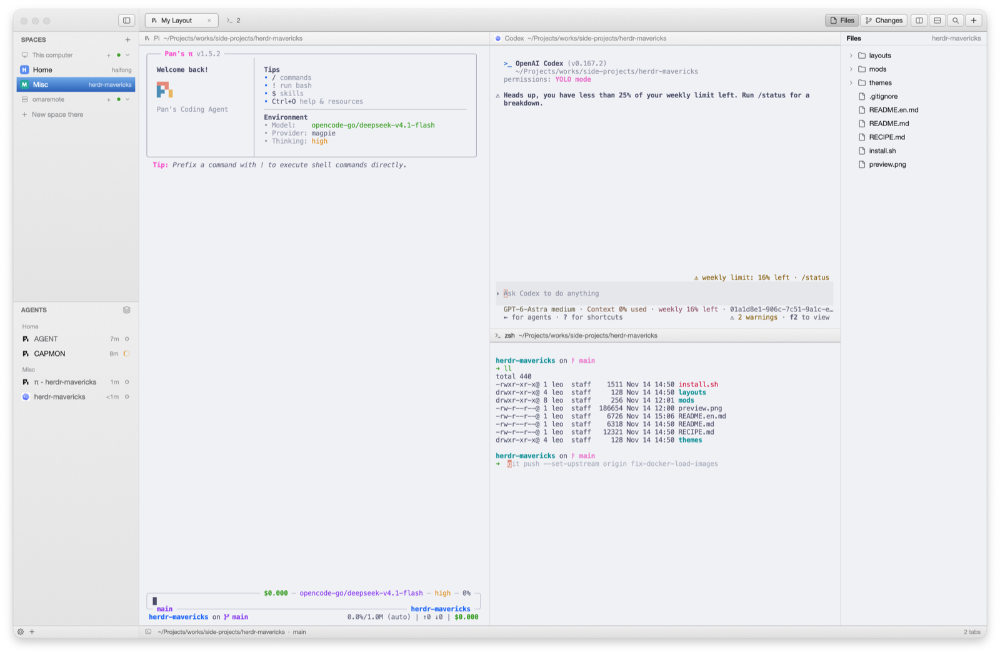
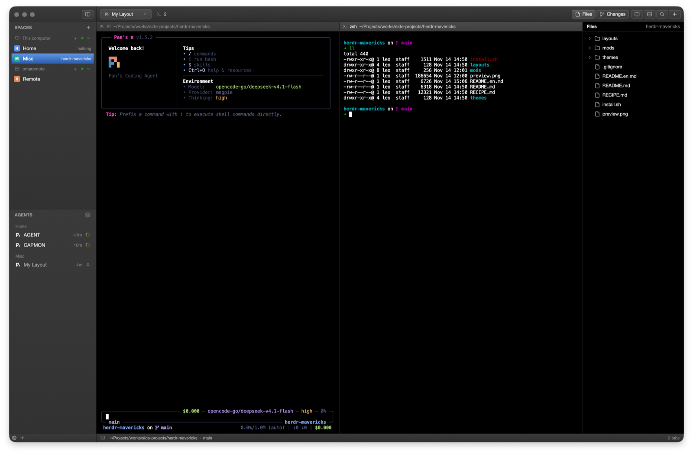

# Herdr · Mavericks

A Herdr window that looks like an OS X 10.9 Mavericks app. A Finder-style sidebar runs the full
height of the window, with the traffic lights in its top row and Settings at its bottom; the work
area has one 40px toolbar holding the tabs and every view button, 24px pane headers that look like
native title bars, and a 22px status bar. Everything is 10.9 Aqua: grey gradients, 1px borders,
system-blue selection, Helvetica Neue, Menlo 12 in the terminals. A second theme does the same
window in dark greys with a graphite terminal.



| Light | Dark |
| --- | --- |
|  |  |

## What you see

Left to right: a 220px sidebar (draggable, min 40, max 480), then the work area. Both run the full height of the window; one 1px divider separates them. The macOS
traffic lights are drawn by the system over the sidebar's top row (`titlebar: none`,
`traffic_lights [12, 13]`).

**Sidebar**, `#ededed → #e3e3e3` top to bottom, 1px `#c6c6c6` on its right (root divider).

- Top row, 40px (`brand`): 78px of empty space for the traffic lights on the left, then a right
  aligned 22px Aqua button with a 14px sidebar icon (tooltip "Hide Sidebar").
- `SPACES` and `AGENTS`: 11px semibold `#6f6f6f` group headings, 24px tall, 14px left inset.
- Space rows, 26px (25px when the space has worktree children), 5px radius, 8px side padding:
  a 16px rounded square in the space's colour with its initial, the name at 12.5px, and on the
  right the branch, ahead/behind. The selected row is a system-blue gradient
  `#6fa8e8 → #2c62b8` with white text and translucent white for the secondary text.
- Agent rows, 26px: the program icon, the name at 12.5px, a pin button on hover, and on the right a
  status dot or an elapsed time. Hover is `#d9d9d9`.
- Bottom row, 22px (`footer`): two 18px icon buttons, a 12px gear (Settings) and a 12px plus
  (Add machine), `#d8d8d8` on hover, 1px `#c6c6c6` above.
- Narrowed below 160px the sidebar becomes a 68px icon rail: rows of 24px, 6px inset on both
  sides, 4px gap, and a 6px-wide dot column holding one 5px dot; the selected row's highlight
  spans the whole rail. Machine (16px icon), space (16px colour square) and agent (16px program
  icon) rows share that grid, so icons and dots line up vertically. Dots: machine green when
  connected, grey when not; space working orange, blocked red, done green (none when it does not
  need you); agent idle grey, working orange, blocked red, done green. There is no expand button
  in the rail: `cmd-b` brings the full sidebar back.

**Toolbar**, 40px (`chrome`), `#efefef → #d9d9d9`, 1px `#9a9a9a` below. It is also a window drag
area. Tabs start at the sidebar's right edge, so they line up with the panes under them.

- Tab, 26px high, 5px radius, 9px side padding, 6px gap, 11.5px Helvetica Neue: program icon
  13px, name (max 170px, truncated, ` ⌃` when zoomed), a fixed 12px status slot, a fixed 13px
  close slot. The active tab is `#f6f6f6 → #ededed` with a 1px `#a5a5a5` border and a small
  shadow; others are transparent and `#e2e2e2` on hover. The status slot shows an 11px orange
  spinner while working, a 6px red dot when blocked, a 6px green dot when done, nothing when idle.
  The close `×` is transparent until the tab is active or hovered, then `#d5d5d5` on hover.
- Right side, each a separate 22px Aqua capsule (4px radius, `#f8f8f8 → #e6e6e6`, 1px `#b8b8b8`,
  1px `#ffffffcc` inner highlight, 11.5px label, 5px gap, 7px side padding): `Files` (14px icon,
  only when the layout has the panel), `Changes`, then icon-only Split Right, Split Down, Find,
  and a `+` for New Tab. Toggled buttons use `#d6d6d6 → #bcbcbc` with a `#a8a8a8` border. No
  joined segmented control anywhere.

**Pane area**: each pane has a 24px header (`pane`), `#f2f2f2 → #e4e4e4` when focused,
`#f5f5f5 → #ededed` when not, with a 1px `#a8a8a8` bottom edge. Inside: 12px program icon, 11.5px
medium title (max 320px), then the `~/…` folder in `#5f5f5f` (focused) or `#8d8d8d`. On hover it
also shows 18px buttons for Split Right, Split Down, Zoom and Close (`#dedede` on hover). Panes
have no border and no focus ring: the 1px seams between panes, and between a pane and the panel,
are a 1px gap over the work area's `border` colour (`#b8b8b8` light, `#1d1d1d` dark). Focus is
shown by the header gradient only.

**Files / Changes panel** (hidden by default, 300px, 220–560): flat, `background` coloured, 24px
header with a 11.5px semibold title and a hairline below, 24px rows at 12px, 4px hover radius.
Changes adds a 24px commit row: 24px input (accent border while typing) and a 24px Commit button.

**Status bar**, 22px (`status`), `#ededed → #dedede`, 1px `#b0b0b0` above: a 12px terminal glyph,
the focused pane's `~/path  ·  branch` at 10.5px `#5f5f5f`, the tab count, and 6px agent-status
dots with counts for working / blocked / done (only the non-zero ones).

**Terminal**: white on the Terminal.app Basic palette in the light appearance; graphite `#1f1f1f`
background with `#ededed` text in the dark one (Homebrew hues lifted for graphite). Menlo 12.

**Dark appearance** is the same structure in dark greys: sidebar `#3a3a3a → #323232`, toolbar
`#424242 → #353535`, active tab `#4c4c4c → #424242`, pane header `#4a4a4a → #3f3f3f` (dimmed when
unfocused), status bar `#3a3a3a → #2f2f2f`, text `#eaeaea` / `#b3b3b3` / `#838383`, and the
selection blue lifted one step (`#5f97e4 → #2b5cae`).

## How it behaves

- **Appearance follows the system**: the layout sets `theme: { light: "mavericks", dark:
  "mavericks-dark" }`, so the sidebar, toolbar, tabs, pane headers, status bar, menus, panels and
  terminal all change within about a second of the system switching. The theme menu only changes
  the half of the pair you are in.
- **Window drag**: the `brand` row and the `chrome` row are `window_drag: true`. Every button and
  every tab calls `cx.stop_propagation()` on mouse down, so clicking them never drags the window.
- **Tabs**: click selects (`tab.select`), double-click renames (`tab.rename`), press and release on
  another tab moves it (`tab.move`), right-click opens `mavericks-menu` with `{tab: "tab"}`.
  The strip is `overflow_x_scroll` with no visible scrollbar: when tabs overflow, the wheel pans
  the strip sideways instead of switching tabs (switching stays on click, `cmd-shift-[` /
  `cmd-shift-]`, `cmd-1..9`). Widths never jump because the close and status slots always keep
  their size.
- **View buttons**: `Files` / `Changes` toggle the panel with `layout.show` / `layout.hide` after
  `layout.select { stack: "panel-body", child: … }`; Split Right / Split Down run
  `pane.split { direction }`; Find runs `terminal.search`; `+` opens Herdr's own `new-menu`
  overlay (`openOverlay({ mod: "new-menu", kind: "popup", width: 250, height: 512 })`).
- **Collapsing the sidebar**: the brand button and `cmd-b`. The button stores the current width in
  shared state (`sidebar.width`) and calls `layout.resize { id: "sidebar", px: 68 }` (44 off
  macOS), or restores the stored width. With the sidebar hidden, the toolbar sits at the window's
  left edge and pads itself by `traffic_lights[0] + 64` (divided by zoom, minus the sidebar width
  when it is still visible), so tabs never sit under the traffic lights.
- **Spaces**: click selects (`space.select`), drag reorders (`space.move`), right-click opens the
  menu with `{tab: "space"}` (rename, worktree items when the folder is a git checkout, close).
  The selected row follows `spaces()[i].active`.
- **Agents**: click focuses the pane (`pane.focus { pane }`); hover shows a pin
  (`terminal.pin`). The status dot follows `agent.status`.
- **Pane header**: click focuses, double-click zooms (`pane.zoom`); the hover buttons run
  `pane.split`, `pane.zoom`, `pane.close`. A working pane shows the same 11px spinner, blocked and
  done a 7px dot in the theme's status colours.
- **Sidebar footer**: the gear runs `app.settings`, the plus runs
  `mod.open { name: "machine-add" }`.
- **Status bar** re-renders from `focused()`, `panes()`, `agents()`; no polling.

## Built from

Root node (all sizes are layout px at zoom 1; Herdr scales the whole tree):

```
row root { theme: {light: mavericks, dark: mavericks-dark}, font: Menlo, font_size: 12,
           ui_font: Helvetica Neue, titlebar: none, traffic_lights: [12, 13],
           background: canvas, divider: {width: 1, color: border}, preview: layouts/mavericks.png }
├─ column sidebar (220px, min 40, max 480)
│  ├─ block brand   (40px, window_drag, mod mavericks, props.role = brand)
│  ├─ block spaces  (mod mavericks-spaces)
│  ├─ block agents  (mod mavericks-agents)
│  └─ block footer  (22px, mod mavericks, props.role = footer)
└─ column work
   ├─ block chrome  (40px, window_drag, mod mavericks, props.role = chrome)
   ├─ row work-body (gap 1, background: border)
   │  ├─ block main (tab: active, lone: true)
   │  │    pane: { gap: 1, radius: 0, background: background, border: {width: 0},
   │  │            focus: {width: 0}, header: {height: 24, position: top, reveal: always,
   │  │                    content: {mod mavericks, props.role = pane}} }
   │  └─ column panel (300px, min 220, max 560, hidden)
   │       └─ stack panel-body (active: files) → block files (mavericks-files),
   │                                          block changes (mavericks-changes)
   └─ block status  (22px, mod mavericks, props.role = status)
```

- `mods/mavericks/` — one mod, five roles. `main.js` picks the class from `props.role` and calls
  `watchAppearance(cx)`. `brand.js`, `chrome.js` (tabs and toolbar buttons), `pane.js`,
  `status.js`, `footer.js`. `kit.js` holds the palette, `gradient()`, `hairline()`, `icon()`,
  `toolbarButton()`, `segment()`, `trafficLight()`, `ui()`, `palette()`, `watchAppearance()`.
  `LIGHT` and `DARK` are two full 10.9 palettes; `palette()` picks one by the perceived luminance
  of `theme().chrome` (above 0.5 → light). Icons are 16×16 `currentColor` line drawings in
  `mods/mavericks/assets/icons/`.
- `mods/mavericks-spaces/` and `mods/mavericks-agents/` — clones of Herdr 0.1.15's `spaces` /
  `agents` (`mod.json` records `cloned_from`), with only the looks changed: Helvetica Neue,
  26px rows (24px rail rows), 5px radius rows, system-blue gradient selection, 11px semibold
  headings, 6px dot column. Their gradients use `globalThis.window.paint_path`, because those
  files import Herdr's window state under the name `window`.
- `mods/mavericks-menu/` — a rewrite of the shipped `menu` items (pane / tab / space / global,
  including the worktree entries), no icons, 22px rows, 4px radius, 210px popup, blue selection,
  right-aligned shortcuts, ↑/↓/Enter/Esc kept. `kit.js` is a trimmed palette copy.
- `mods/mavericks-files/` and `mods/mavericks-changes/` — clones of the shipped `files` /
  `changes`, only the render changed (no radius, no card, 24px header and rows, Helvetica Neue
  12, `#b8b8b8` hairlines). Icons still come from `mods/files/*.svg`.
- `themes/mavericks.json` — `colors.selected: #6fa8e8` (the light end of system blue: Herdr's own
  overlays draw row text in `colors.foreground`, which must stay readable on the selection),
  background `#fdfdfd`, foreground `#1b1b1b`, ANSI 0–15 = Terminal.app Basic, and chrome / canvas
  / accent / status colours overridden to 10.9 values (`border: #b8b8b8`).
- `themes/mavericks-dark.json` — chrome `#333333`, canvas `#262626`, raised `#3a3a3a`, hover
  `#303030`, border `#1d1d1d`, selected `#2f5f9f`, terminal `#1f1f1f` on `#ededed`, ANSI 0–7 from
  Homebrew lifted for contrast, 8–15 with blue and grey lifted.
- Herdr APIs used: `layout()`, `spaces()`, `panes()`, `agents()`, `focused()`, `terminals()`,
  `machines()`, `theme()`, `settings()`, `home()`, `shared()` / `setShared()`, `run()`,
  `openOverlay()` / `closeOverlay()`, `exec()`, `window()`, `watchFolder()`, `cx.timer.every`.
  Commands: `tab.select|rename|move|close|new`, `pane.focus|split|zoom|close`,
  `terminal.search|pin|right_click|park`, `space.select|move|new|rename|close`, `worktree`,
  `layout.show|hide|select|resize|switch`, `app.settings`, `app.help`, `mod.open`.
- Programs run: `git` (`rev-parse`, `status`, `add`/`commit` for the Changes commit bar), `sh`
  (directory listing in Files, PowerShell on Windows). No network access.
- No third-party assets: the icons are 16×16 SVGs in the repo; the traffic lights are drawn by
  macOS.

## Watch out

- **One 1px seam only.** The sidebar/work divider is the root `divider`. Pane `border` and `focus`
  are both width 0, and `work-body` uses `gap: 1` with `background: "border"`. Do not add a border
  to a pane or a panel as well: a focus border next to the divider becomes a 2px line. Focus is
  carried by the header gradient.
- **Hard-coded colours break the dark appearance.** The layout originally used `#e9e9e9` and
  `#b8b8b8`; those must be theme tokens (`canvas`, `border`) or the seams and the canvas stay
  light when the mode flips.
- **Themes are named after the layout.** A theme whose name equals a layout only appears in
  Settings while that layout is shown, which is what this pair relies on. Rename layout or themes
  together.
- **Herdr does not redraw layout mods when the theme changes.** `theme()` is live but no view is
  woken up, so each mod runs a once-a-second signature check (`chrome|foreground`) and only then
  calls `cx.notify()`. The cost is up to about a second of mixed colours after a switch; a poll
  without the signature check would redraw forever.
- **`globalThis.window` inside clones.** `mavericks-spaces` / `-agents` import Herdr's window state
  as `window`, shadowing the global; use `globalThis.window.paint_path` there.
- **`colors.selected` cannot be the deep system blue.** Herdr's unskinned overlays (command
  palette, Settings, picker) draw row text with `colors.foreground`, so the deep blue leaves dark
  text unreadable. `#6fa8e8` is the compromise.
- **Overlays keep their corners square.** Herdr's overlay frame rounds its own 1px border but does
  not clip the mod's square background, so a small light square shows outside the rounded corner.
  Cloning the built-in mod and clipping its own root hides it, at the cost of falling behind Herdr
  updates, so this repo does not do it.
- **Some overlays cannot be reskinned at all**: close confirmation, rename prompts, `new-menu`,
  picker, Settings, and the command palette call their mods by fixed names and only follow theme
  colours. The context menu is replaced by `mavericks-menu` on tabs, spaces and panes; tab-bar and
  terminal right-clicks still reach Herdr's own menus unless `terminal_menu` is set in the layout.
- **The terminal find bar is not a mod** (`terminal.search` is built in): the padding of its
  `find` field cannot be changed.
- **Clones drift.** `mavericks-spaces` / `-agents` / `-files` / `-changes` are Herdr 0.1.15
  builds. After a Herdr upgrade run `herdr-app check` and diff against the shipped mods; when the
  internals moved, re-clone (`mod.clone`) and re-apply the styling in `kit.js` and the row
  renderers.
- **Layouts get normalised.** If Herdr rewrites the tree, root-only fields such as `titlebar`,
  `traffic_lights` and the fonts can end up nested and lose their effect; reinstall from the repo
  and `layout.switch --name mavericks` to restore.
- **Sub-pixel hairlines.** Pressed grey states and 1px lines can land on half pixels when the app
  zoom is not 1; that is Herdr scaling the layout, not a mod bug.
- **`herdr-app shot` misses the traffic lights** on macOS: the system draws them above the layout.
- **No Dock, Launchpad, menu bar or sounds**: outside the window content, or needing an extra
  always-on floating block.
- Fresh clone and other operating systems: `install.sh` copies `layouts/`, `themes/`, `mods/` and
  the layout thumbnail. On Linux/Windows the traffic lights have to be drawn by hand
  (`window().buttons`) and `brand.js` already reserves 8px instead of 78px there.

## Done when

- `herdr-app check ~/.config/herdr-app/mods/mavericks` passes, and so do `mavericks-menu`,
  `mavericks-spaces`, `mavericks-agents`, `mavericks-files`, `mavericks-changes`.
- `herdr-app do layout.switch --name mavericks`, then `herdr-app status` reports no errors and
  `layout: "mavericks"`: the window shows a full-height 220px sidebar (traffic-light gap and
  collapse button on top, Settings / Add machine at the bottom), a 40px toolbar with tabs and the
  Files / Changes / split / find / new buttons, 24px pane headers and a 22px status bar.
- Dragging the sidebar edge moves the tab strip with it, and both the sidebar seam and the pane
  seams are exactly 1px.
- `cmd-b` (or the brand button) collapses the sidebar to the icon rail: machine, space and agent
  icons share one column, each with its status dot, the selected row is highlighted edge to edge,
  no tab sits under the traffic lights, and `cmd-b` restores the previous width.
- Right-clicking a tab, a space or a pane header opens the 10.9 menu (22px rows, blue selection,
  right-aligned shortcuts), and its items act on the right target.
- With enough tabs to overflow, the wheel pans the strip (no scrollbar, no tab switch), and the
  active tab scrolls into view; close and status slots keep their width so tabs do not jump.
- Setting `appearance` to `dark` (or switching the system to dark) turns sidebar, toolbar, tabs,
  pane headers, status bar and panels dark and the terminal graphite within a second; switching
  back restores the light window without reopening it or editing files.
- `herdr-app do layout.switch --name main` returns the window to its previous look, and the
  `mavericks` themes disappear from Settings while `main` is shown.
